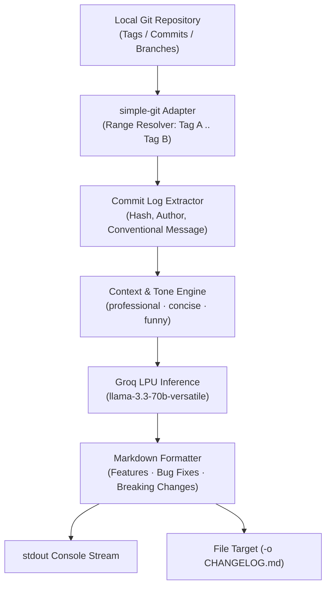

# relnotes — AI-Powered Release Notes CLI Generator

> **Source Repository:** [github.com/Pradeep-B28/Rel_Notes](https://github.com/Pradeep-B28/Rel_Notes)  
> **Author:** [B Pradeep](https://github.com/Pradeep-B28) · [Portfolio](https://pradeep-b28.github.io/Pradeep-B28/)

---

## Overview

**relnotes** is a TypeScript command-line utility that inspects local Git commit histories and generates structured, categorized Markdown changelogs using Groq's high-speed inference engine (`llama-3.3-70b-versatile`).

It parses git tags, extracts commit ranges via `simple-git`, groups changes by semantic conventional commit scopes, and generates tailored release notes across multiple customizable tones in under two seconds.



---

## Technical Specifications

| Component | Technology | Description |
| :--- | :--- | :--- |
| **Runtime & Language** | Node.js 18+, TypeScript 5.3 | Strongly typed CLI with compiled ECMAScript binaries in `dist/` |
| **Git Integration** | `simple-git` | Native local git inspection, automatic tag resolution, and commit diff extraction |
| **LLM Inference** | Groq Cloud API | High-throughput `llama-3.3-70b-versatile` running on Groq LPUs |
| **CLI Framework** | Commander.js | Flag parsing, help text, option validation, and process exit handling |

---

## Tone Presets

- **`professional` (default):** Enterprise-grade changelog formatted by engineering domain (Features, Bug Fixes, Refactors, Breaking Changes).
- **`concise`:** High-density bulleted executive summary (maximum 5 lines).
- **`funny`:** Playful, emoji-accented release bulletin tailored for internal developer chat announcements.

---

## Installation & Setup

### Prerequisites
- Node.js 18.0.0 or higher
- A free [Groq Cloud API Key](https://console.groq.com/keys)

### Local Build & Installation

```powershell
# 1. Clone repository
git clone https://github.com/Pradeep-B28/Rel_Notes.git
cd Rel_Notes

# 2. Install dependencies
npm install

# 3. Build TypeScript to dist/
npm run build

# 4. Link CLI globally
npm link
```

### Environment Configuration

Configure your `GROQ_API_KEY`:

```powershell
# Windows PowerShell:
$env:GROQ_API_KEY = "gsk_your_groq_api_key_here"

# Linux / macOS:
export GROQ_API_KEY="gsk_your_groq_api_key_here"
```

---

## CLI Usage & Examples

### Command Syntax

```bash
relnotes [from] [to] [options]
```

### Options

| Option | Flag | Description | Default |
| :--- | :--- | :--- | :--- |
| `--tone <tone>` | `-t` | Tone of generated notes (`professional`, `concise`, `funny`) | `professional` |
| `--output <file>` | `-o` | Target file path to write release notes to | `stdout` |
| `--help` | `-h` | Display command help and options | — |
| `--version` | `-V` | Output CLI version | — |

### Common Workflows

```bash
# 1. Auto-detect changes between the two latest git tags
relnotes

# 2. Compare a release tag with the current main branch
relnotes v1.0.0 main

# 3. Generate concise changelog and append directly to CHANGELOG.md
relnotes v1.0.0 v1.1.0 --tone concise -o CHANGELOG.md

# 4. Generate a fun Slack release announcement
relnotes v1.1.0 v1.2.0 -t funny
```

---

## License

This project is licensed under the [MIT License](LICENSE).
